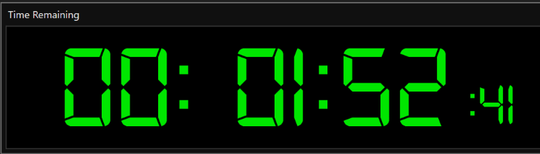

# ID4CountDown

Un semplice countdown per Windows, ispirato al conto alla rovescia di *Independence Day* (1996). Imposta ore, minuti e secondi e avvia il timer, con centesimi di secondo e un display digitale verde.

> Progetto fan-made, non affiliato né approvato dai titolari del film.

## Anteprima

## Ispirazione: *Independence Day*

Immagine del film da [i400calci.com](https://www.i400calci.com/wp-content/uploads/2013/02/ID4_mac.jpg).
